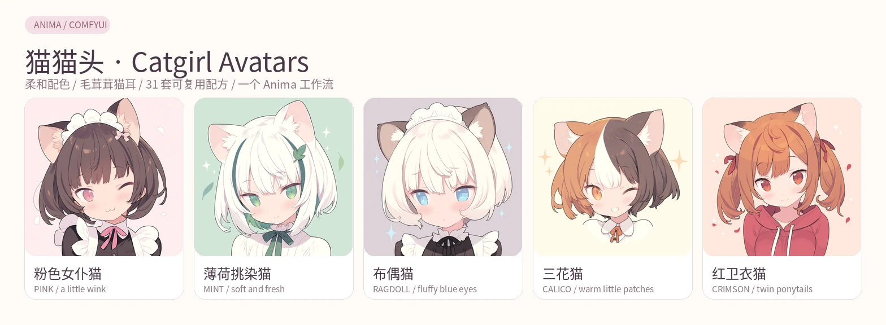
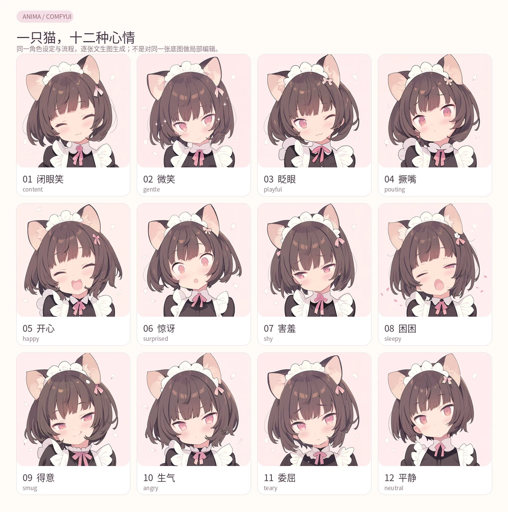
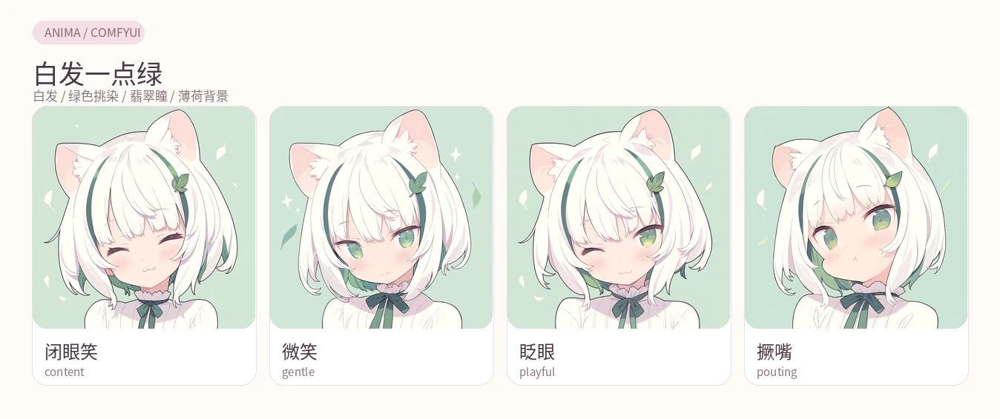
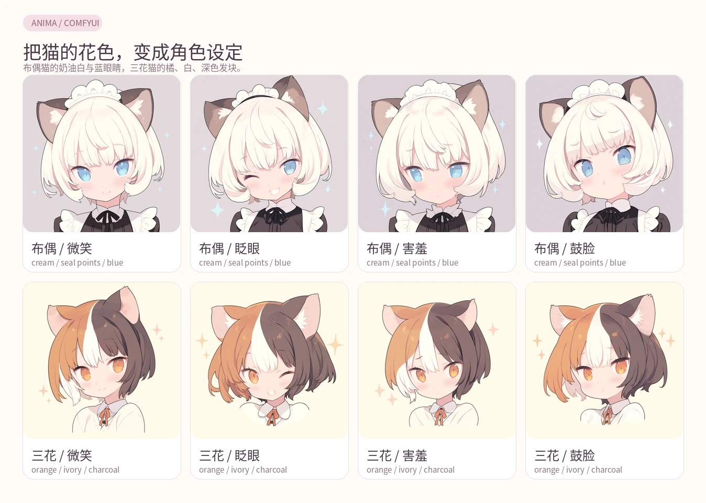
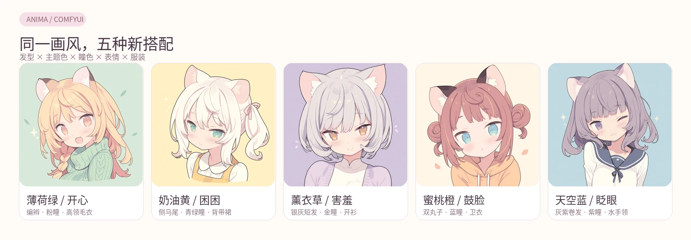
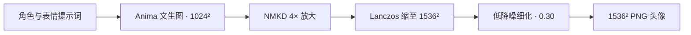

<div align="center">

# 猫猫头 · Catgirl Avatars

**把一只猫的十二种心情，放进你的头像框。**

柔和配色、蓬松猫耳与大脸特写。分享成品，也分享它们的完整 Anima 配方。

**31 张成品 · 12 种表情 · 1 个 ComfyUI 工作流 · 纯文生图**

[看全部头像](docs/GALLERY.md) · [下载工作流](workflows/anima-avatar-hd.workflow.json) · [准备模型](docs/MODELS.md) · [修改提示词](docs/PROMPTING.md)



</div>

这个项目来自一组反复调整出来的猫娘头像。我们想留下的，是细腻的线条、轻柔的明暗、毛茸茸的头发，以及缩成小头像后依然清楚的表情。

最后最喜欢的是粉色女仆猫和绿色挑染猫，所以以它们的 **Anima Base v1.0** 流程为基础，继续做了猫种、服装与配色变化。这里收录的是筛选后的成品及对应配方，图片均为 **1536 × 1536 PNG**。

## 一只猫，十二种心情

粉色女仆猫「铃音」是这组头像的起点。闭眼笑、微笑、眨眼、撅嘴、开心、惊讶、害羞、困困、得意、生气、委屈和平静，都留在同一套角色设定里。



每张都是独立文生图：共享角色描述、画风和流程，再替换表情提示词。它们适合当作一组头像或聊天表情；发丝、脸型与角度仍会有自然差异，**并非严格对齐的 Live2D 分层素材**。

## 从一套画风，长出不同的猫

### 白发一点绿

白发、翡翠色挑染与绿色眼睛，配一点小叶子和薄荷底色。



### 布偶与三花

把猫的毛色写进角色：布偶猫用奶油白、深色重点色和蓝眼睛；三花猫把橘、白、深色分成清楚的发块。每组都有四种表情。



### 五种随机搭配

发型、主题色、瞳色、表情和服装分别组合。仍使用同一条 Anima 流程，看看熟悉的笔触能长出什么新形象。



另收录红卫衣双马尾猫，以及细尾鹩莺配色灵感的蓝色猫娘。[完整画廊 →](docs/GALLERY.md)

| 系列 | 配方前缀 | 张数 |
|---|---|---:|
| 粉色女仆猫 / 十二表情 | `lingyin/` | 12 |
| 绿色挑染猫 | `green-cat/anima/` | 4 |
| 布偶猫 | `ragdoll/` | 4 |
| 三花猫 | `calico/` | 4 |
| 红卫衣双马尾 | `red-hoodie/` | 1 |
| 五种随机搭配 | `random-cat-avatars/` | 5 |
| 蓝色猫娘 | `fairywren/` | 1 |

## 先跑出第一张

需要 **支持 Anima 的 ComfyUI** 与四个模型文件。模型权重不随仓库分发，下载入口、文件夹和 SHA-256 见 [模型准备](docs/MODELS.md)。本工作流使用 ComfyUI 原生节点，无需安装项目专用节点。

### 直接在 ComfyUI 中打开

1. 下载本仓库，按 [模型准备](docs/MODELS.md) 放好文件。
2. 把 [`anima-avatar-hd.workflow.json`](workflows/anima-avatar-hd.workflow.json) 拖进 ComfyUI；默认是女仆猫闭眼笑。
3. 检查三个模型加载器与放大模型的文件名，点击 **Queue / 运行**。
4. 正向与负向提示词各有一个文本节点；换表情可从脚本导出完整配方，避免漏改负向词。

### 用脚本选择表情

脚本需要 **Python 3.10+**，仅用标准库。绘图由已启动的 ComfyUI 执行。

```bash
git clone https://github.com/SpiralKernel/catgirl-avatars.git
cd catgirl-avatars

# 不连接 ComfyUI，也能列出与导出配方
python generate.py list
python generate.py export lingyin/03_wink --out exports/maid-wink.workflow.json

# ComfyUI 默认地址：http://127.0.0.1:8188
python generate.py check --filter lingyin/
python generate.py run lingyin/03_wink

# 一次画多张；每个配方依次运行
python generate.py run calico/01_smile calico/02_wink calico/03_shy calico/04_pout
```

新图保存在 `outputs/<配方名>.png`，不会覆盖已有图片。也可以把 ComfyUI 放在另一台机器上：

```bash
python generate.py run ragdoll/03_shy --seed 20261008 \
  --url http://127.0.0.1:8188 --out-dir outputs/my-cats

# 不同文件名可显式映射；原来的 anima_baseV10 别名也会自动识别
python generate.py check --model unet_name=my-anima-base-v1.safetensors

# 导出完整 API 图，供自己的 ComfyUI 客户端使用
python generate.py export green-cat/anima/03_wink --format api --out exports/green-wink.api.json
```

`check` 只检查依赖，不消耗一次绘图。模型缺失会明确报错，不会悄悄换模型。[流程细节与排错 →](docs/WORKFLOW.md)

## 这套画风怎么来

我们使用了 `@blade \(galaxist\)`、`pastel colors`、`delicate lineart`、`soft shading` 等画风词，再用自然语言描述头发、猫耳、衣领、配色和表情。头像构图有两个关键点：**脸占大部分画面，猫耳完整入框**。

整个流程从空 latent 开始，不需要参考图、ControlNet 或图生图输入：



| 参数 | 基础生成 | 高清细化 |
|---|---|---|
| 模型 | Anima Base v1.0 | 同左 |
| 采样器 / 调度器 | Euler ancestral / simple | 同左 |
| 步数 | 36 | 16 |
| CFG | 4.5 | 4.5 |
| 降噪 | 1.00 | 0.30 |
| 尺寸 | 1024 × 1024 | 1536 × 1536 |

初始系列共用种子 `3444821748`；随机系列保存了各自的种子。模型、采样器与环境变化可能影响结果，不承诺跨设备逐像素一致。完整正向词、负向词与参数差分都在 [`generate.py`](generate.py) 的 `VARIANTS` 中。[如何做自己的猫 →](docs/PROMPTING.md)

## 仓库里有什么

```text
catgirl-avatars/
├── README.md
├── generate.py             # 一套节点结构 + 31 套提示词/种子差分 + CLI
├── workflows/              # 可直接导入 ComfyUI 的共享流程
├── images/                 # 31 张原尺寸成品 PNG
├── catalog.json            # 配方、图片路径、尺寸与文件校验值
├── models.json             # 四个所需模型的文件名、来源和校验值
├── docs/                   # 画廊、模型准备、流程与提示词说明
├── scripts/build_gallery.py # 从真实成品重建 README 配图
└── tests/                  # 配方、导出与 API 行为检查；无需 GPU
```

每种表情都保存完整提示词，但不复制一套节点图。README 的展示图由原成品排版生成，缩略图用于浏览，原尺寸 PNG 保留在 `images/`。

## 致谢与使用说明

感谢 [ComfyUI](https://github.com/Comfy-Org/ComfyUI)、[CircleStone Labs / Anima](https://huggingface.co/circlestone-labs/Anima) 和 NMKD 的 [UltraYandere Lite](https://openmodeldb.info/models/4x-NMKD-UltraYandere-Lite)。提示词保留了生成时使用的画师标签，不表示与相关画师存在合作或授权关系。

本项目的脚本、原创工作流与文档使用 [MIT License](LICENSE)。AI 生成示例图可供个人头像与学习参考，转载请注明出处；其他使用说明见 [IMAGES.md](IMAGES.md)。模型权重遵循各自的上游许可，仓库许可不覆盖模型。

想贡献新猫猫头，可按 [贡献说明](CONTRIBUTING.md) 增加一个配方和一张筛选后的成品。欢迎带着效果图来交流。
